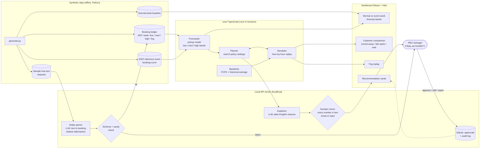

# Architecture: FBO parking planner (Super Bowl LXI week, HHR)

**One sentence:** forecast parking demand from live bookings, recommend a parking policy per demand level, prove it beats first-come-first-served and a historical-average rule in simulation, and let a manager approve every recommendation.

## Binding rules (from the NCBAA brief)
1. Planning support only. The tool never grants slots, moves aircraft, or turns a customer away.
2. Every recommendation goes through a human approval gate (approve / edit / reject), and the decision is logged.
3. Show assumptions and uncertainty (low / medium / high bands) everywhere a number appears.
4. No personal data: no tail numbers, owner or passenger names. The intake step redacts them.
5. The LLM never produces a number. Numbers come from the forecast and planner code. The LLM only parses text and explains.

## Components
| # | Component | What it does | Where it runs |
|---|---|---|---|
| 1 | Data generator (`data/generate.py`) | Synthetic flights, **booking ledger** (when each booking was made), a **2022 reference event** history, normal weeks, sample free-text requests | Offline, Python |
| 2 | Intake parser | Free-text request → structured booking `{size, arrive, depart, stay}`. Redacts tails and names. Schema-validated; rejects go to a human. | Local server → LLM API |
| 3 | Forecaster (pickup model) | `final demand = bookings on hand + expected pickup at this lead time`, learned from the 2022 reference booking curve. Gives low / medium / high bands, and matches the current pace to a scenario. | `core/` TS, browser |
| 4 | Planner (optimizer) | Searches policy settings (overnight cap per size per night, drop-and-go-only trigger, overflow airport order) and picks the one with the fewest turned-away jets and least waiting, scored by the simulator | `core/` TS, browser |
| 5 | Simulator | Replays a week of bookings hour by hour under a policy. Outputs turned away, peak ramp use, idle spots, wait time. | `core/` TS, browser |
| 6 | Baselines | (a) First-come-first-served, (b) historical-average rule ("2022 final × growth factor") | `core/` TS |
| 7 | Explainer | Turns planner output into a plain-English reason per recommendation. Post-check: every number in the text must appear in the input. | Local server → LLM API |
| 8 | Approval + audit | Recommendation cards → approve / edit / reject + note → stored with timestamp | Local server + SQLite |
| 9 | Dashboard | Normal vs. event week, forecast bands, plan per scenario, 3-planner comparison, fog replay, approval queue | React + Vite |

## Why it beats a rule or historical average
- **Live updating.** The pickup model re-forecasts as bookings arrive. A static average can't react when pace runs ahead of 2022 or a big-market team qualifies.
- **Mix, not count.** The planner decides *which* demand gets the 60 spots by size and stay length. "60 spots, first come" can't.
- **Measured, not claimed.** The simulator scores all three planners on the same weeks (low / medium / high / fog). If ours doesn't win, we see it before the judges do.
- **Accuracy is testable.** Forecast at T-30 / T-14 / T-7 / T-3 days vs. the final (synthetic) outcome, for pickup vs. historical average.

## Human-only decisions (answer to "what should AI never decide")
- Granting or denying a slot or parking reservation to a specific operator
- Moving or repositioning any aircraft
- Overriding airport safety procedures, FAA programs, or ATC instructions
- Setting event fees or prices

## Risks / checks
- Runs locally for the demo; no deploy. The LLM key stays in the local server, never in the browser. Have cached LLM outputs as a fallback if venue Wi-Fi drops.
- The pickup model needs a reference booking curve. Ours is synthetic (2022-shaped) and must be listed in ASSUMPTIONS.md.
- Accuracy numbers are on synthetic data. Say so in the pitch.

## Stretch: LA 2028 Olympics
Event profile as config (dates, daily demand shape, reference curve). Same engine, new profile.

## Diagram

